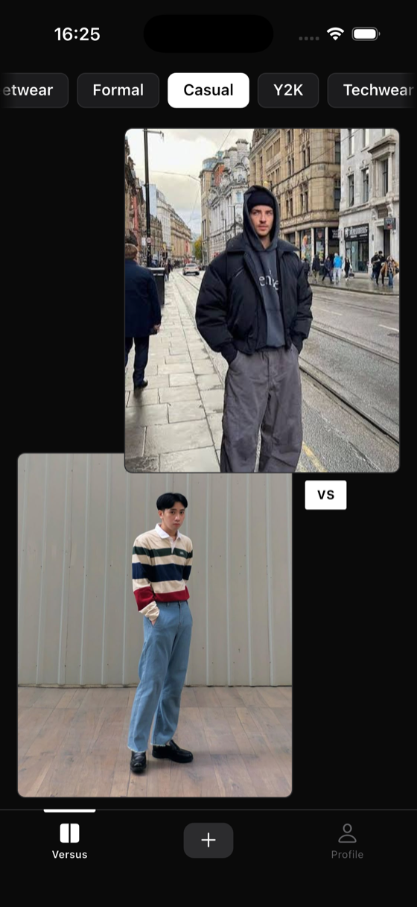
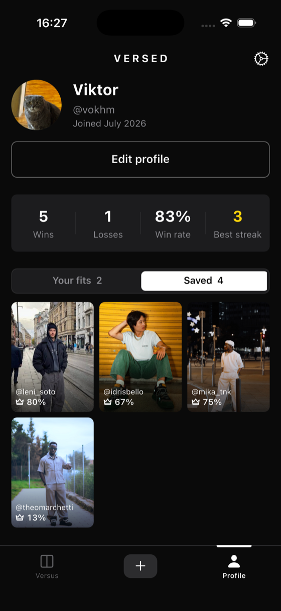

<p align="center">
  <picture>
    <source media="(prefers-color-scheme: dark)" srcset="docs/brand/versed-logo-dark.svg">
    
  </picture>
</p>

<p align="center">
  <b>Style, compared.</b><br>
  Two outfits, one double-tap. A head-to-head outfit battle app for iOS and Android.
</p>

<p align="center">
  <a href="#-screenshots"></a>
  <a href="DESIGN.md"></a>
</p>

<p align="center">
  
  
  
  
  
  
  
  
</p>

A Flutter app for head-to-head outfit battles and curation. State-managed with Riverpod, and powered by Supabase for auth, Postgres, and media storage. Votes and matchmaking run through `security definer` database functions rather than Realtime subscriptions — the arena keeps its own prefetched queue instead of listening for pushes.

---

## 📱 Screenshots

| The arena | Your profile |
|:---:|:---:|
|  |  |
| A pair drawn from one category — double-tap the one that wins. | The battle record, over the grid of fits you have saved. |

---

## 🛠 Tech Stack

* **Framework:** Flutter (iOS / Android)
* **State Management:** [Riverpod](https://riverpod.dev) (**Manual provider declaration only** — no code generation, `@riverpod`, or `build_runner`).
* **Backend & Auth:** [Supabase](https://supabase.com) (PostgreSQL, Supabase Auth with Google OAuth, Storage).
* **Navigation:** Navigator 1.0 with `CupertinoPageRoute` (plus a custom transparent `FitViewerRoute` for the photo zoom). What a launch lands on — sign-in, pick-a-handle, or the app — is decided by the `AuthGate` widget rather than a router redirect.
* **Other key packages:** `image_picker` (camera/library uploads), `image` (pure-Dart crop, so it runs in an isolate), `shared_preferences` (local flags like onboarding hints), `share_plus` and `gal` (exporting fit photos to the share sheet or camera roll).

---

## ✨ Features

* **Google Sign-In** — Supabase Auth with a native-feeling auth page (animated outfit matchup hero, Google-branded button). An `AuthGate` routes signed-out users to the auth page, holds signed-in users without a handle at a pick-a-handle step, and sends everyone else into the app.
* **Home shell & tab bar** — a persistent `HomeShell` keeps the Versus, Upload, and Profile tabs alive in an `IndexedStack` so state survives switching. `AppTabBar` renders a sliding indicator behind the active tab with animated icon/text transitions.
* **Genres** — every fit declares one of six genres (streetwear, formal, casual, Y2K, techwear, vintage), chosen in the upload picker. Matchmaking pairs within a genre, so voters judge how well an outfit is put together rather than which style they prefer. The arena supports filtering the queue by category, with image preloading and a sync-reveal optimization so switching genres doesn't stall on network fetches, and an animated `_GenreRevealBanner` announces the active genre without shifting the board layout. Real outfits are entered and tagged by hand with `tool/tag_fits.dart`.
* **Live matchups** — the arena asks `next_matchup()` for a pair the user has not judged yet, keeping a small prefetched queue so the next battle appears the instant a winner is crowned. Votes go through `cast_vote()`, which records the vote and moves both fits' counters — wins, losses, and the winner's streak — in one transaction. A skeleton loading state (`MatchupBoardSkeleton`, built on the shared `AppSkeleton` shimmer) covers the gap while the first matchup loads.
* **Uploads** — pick from camera or library, preview in the same 4:5 frame the arena crops to, pick the genre it competes in, then enter. Photos live in a public `fits` storage bucket under the owner's uuid.
* **Saved fits** — bookmark someone else's fit from the arena (the icon on a highlighted card, or the long-press sheet) or from the viewer. Saves are private, and they survive the fit itself: a retired fit stays in the grid as a placeholder tile rather than vanishing without explanation.
* **Fit viewer** — tap a fit in a profile grid — your own, your saved, or someone else's — to open it full-screen with a hero transition, its view count, win rate and any run it is on, and actions to share it or save it to a `VERSED` camera-roll album via `FitExportService`. Both actions re-download the full-size original rather than reusing the screen-scaled image already on display. The arena has no viewer: a card there is for judging, not browsing.
* **Public profiles** — the owner's handle is a way through to them, both under a fit in the viewer and on a highlighted arena card: it opens a read-only `PublicProfilePage` with their identity, battle record and live fits. No settings, no edit button, and no saved section — what someone has bookmarked stays private to them. Backed by `publicProfileProvider`, an auto-disposed family that reads the profile row, `profile_stats()`, and their fits in one go.
* **Moderation** — long-press a fit in the arena for a sheet that offers saving it or reporting it; a reported fit leaves the pool once enough people agree. Retiring your own is a soft delete — open it from the profile grid and pick "Retire fit" from the overflow menu, then confirm. The row survives so the battles it already fought still count for the fits it faced; only the photo is purged.
* **Settings** — account preferences and sign-out live on a dedicated settings page off the profile tab, reached via `AppNavigationBar`.
* **App island** — an overlay pill for confirmations and errors that, on Dynamic Island hardware, opens from the exact footprint of the cutout so the notification reads as the cutout itself stretching open; on every other device it floats under the status bar instead.
* **Versus battles** — the main screen pits two 4:5 outfit photos against each other in a diagonal layout (bottom-left vs top-right) with a VS badge at the seam:
  * **Tap** an outfit to pre-highlight it (subtle scale + brighter border, auto-clears after 2s).
  * **Double-tap** to crown the winner — it scales up with an accent glow while the loser dims, a small burst of emojis arcs and falls from the tap point, then the next pair fades in.
  * Graded haptic feedback (selection tick on tap, medium impact on the winning double-tap) and full reduce-motion support.
  * A highlighted card reveals what the vote is allowed to know: the owner's handle at the foot of the card (tappable, opening their profile), the win count beside a custom crown icon, and the bookmark. All three go away again once a winner is out.
  * **Streaks** — crowning a winner reveals an amber flame badge in the bottom-right corner of that card when the fit is on two or more straight wins. It is withheld until the vote is in on purpose: a visible run would nudge the pick it is supposed to be the result of. The number is live — `VersusController` applies the vote to the on-screen pair before the request goes out, so the streak ticks up with the reveal animation rather than a round trip later.

---

## 📁 Project Architecture

The design system and shared plumbing live in `core/`; every feature is its own module under `features/`.

```text
lib/
├── main.dart                     # Entry point — AppInitializer, then runApp
├── core/                         # Shared app foundation
│   ├── theme/                    # Design system (colors, typography)
│   ├── services/                 # Global services (Supabase, Storage)
│   ├── utils/                    # Validators, formatters, error messages
│   ├── widgets/                  # Shared UI (AppButton, AppTabBar, AppSkeleton, AppIsland, loaders)
│   └── presentation/
│       ├── pages/                # Internal component showcase (design_system_page)
│       └── widgets/
└── features/
    ├── auth/                     # Google sign-in, AuthGate, auth page
    ├── fits/                     # Fit model, queries, fit viewer, export (share / save to camera roll)
    ├── versus/                   # Outfit battle screen (VersusPage), matchmaking, voting, genre filtering
    ├── upload/                   # Photo picker, 4:5 preview, entering the arena
    ├── profile/                  # Profile, battle record, fits grid, handle onboarding, public profiles, settings
    └── home/                     # Signed-in tab shell (HomeShell)
```

### Core Layering

Each feature module is split the same four ways:

| Folder | Holds |
|---|---|
| `models/` | Pure Dart models — manual `fromJson`/`toJson`, `copyWith`, `operator ==`, `hashCode` |
| `services/` | Stateless Supabase queries and API calls |
| `controllers/` | `Notifier` / `AsyncNotifier` managing screen state |
| `presentation/` | Screen pages (`pages/`) and reusable widgets (`widgets/`) |

---

## 🗄 Supabase

Migrations live in `supabase/migrations/`, applied in filename order: profiles baseline, usernames and public profile read, fits, votes and matchmaking, reports, profile stats, the `fits` storage bucket, distinct-owner matchups, fit genres, the matchup genre filter, the `avatars` storage bucket, saved fits, and per-fit streaks. See `supabase/README.md` for the migration workflow.

Writes that have to stay honest are not reachable from the client: `cast_vote()`, `next_matchup()`, `profile_stats()` and `report_fit()` are `security definer` functions, and column-level grants on `fits` mean an owner can only ever write `deleted_at` — never their own win counts.

---

## 🔧 Tooling Scripts

Standalone Dart scripts under `tool/` for backend/content maintenance, all sharing Supabase credential loading from `.env.local` or the environment via `tool/tool_env.dart`:
* `seed_identities.dart` — seeds test user identities.
* `seed_arena.dart` — seeds fits/matchups for local testing.
* `tag_fits.dart` — manually assigns genres to real, hand-picked outfit photos.

---

## 🧑‍💻 Developer Commands

- **Format Code:** `dart format .`
- **Analyze Project:** `flutter analyze`
- **Run in Debug Mode:** `flutter run`
- **Generate iOS Config (SPM):** `flutter build ios --config-only`
